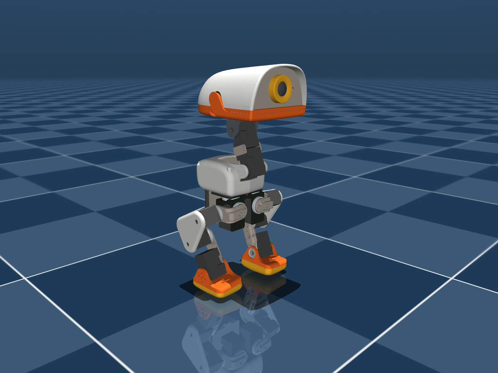

# Microduck 클론

Pollen Robotics / Hugging Face의 25 cm 2족 오리 로봇 **Microduck**을 개인 목적으로 재현하고 재설계하는 프로젝트.
서보 종류에 따라 두 트랙으로 진행한다.



## 한눈에 보기

| | A. 다이나믹셀 — 오리지널 | A. 다이나믹셀 — 저렴한 버전 | B. 일반 서보 |
|---|---|---|---|
| 서보 | XL330-M288-T 15개 + 예비 1 | XL330-M288-T 14개 (부리 고정) | MG996R 11 + MG90S 4 |
| 크기·무게 | 25 cm, 약 0.74 kg | 25 cm, 약 0.74 kg | 약 37 cm (1.5배), 1.4–1.7 kg (추정) |
| 제어기 | Radxa Zero 3W + UART 서보 버스 | 동일 | Raspberry Pi Zero 2W + PCA9685 + ADS1115 |
| 센서 | 몸통 IMU + ToF + 카메라 + 오디오 | 몸통 IMU | 몸통 IMU, 서보 위치는 가변저항 개조로 측정 |
| CAD | Pollen 형상 기반 Fusion 재설계 | 동일 | 1.5배 새 설계 (Open Duck Mini v2 다리 참고) |
| 정책·런타임 | Pollen 것 그대로 | 부리 제외 패치 | 새 액추에이터 모델로 재학습, 파이썬 런타임 작성 |
| 난이도 | 중 | 중 | 상 |
| **비용** (정가 최저가, 배송비 별도) | **약 ₩90만** | **약 ₩56만** | **약 ₩26–28만** |

## 문서 지도

| 알고 싶은 것 | 문서 |
|---|---|
| 다이나믹셀 트랙 전체 계획 (결정 사항, 단계별 구현, 시뮬레이션, 학습) | [`plan.md`](plan.md) |
| 일반 서보 트랙 계획 (토크 분석, 1.5배 설계, 피드백 개조, Pi 제어, 재학습) | [`plan-hobby-servo.md`](plan-hobby-servo.md) |
| 부품·가격·구매 링크 (3개 버전 비교) | [`bom/BOM.xlsx`](bom/BOM.xlsx), [`bom/BOM.csv`](bom/BOM.csv), [`bom/BOM_hobby_servo.csv`](bom/BOM_hobby_servo.csv) |
| Fusion + Claude로 CAD 재설계하는 방법 | [`cad/FUSION_REDESIGN.md`](cad/FUSION_REDESIGN.md) |
| 알루미늄 판재 가공 부품 (DXF) | [`cad/plates/`](cad/plates/) |
| 원본 CAD 자료 (MJCF·STL·관절 프레임) | [`cad/reference/`](cad/reference/) |
| 서보 ID·레지스터·버스·전원 사양 | [`docs/hardware-notes.md`](docs/hardware-notes.md) |
| IMU 브리지 보드(버스 ID 200) 펌웨어 사양 | [`firmware/imu_to_dxl/`](firmware/imu_to_dxl/) |
| 자작 HAT 보드 계획 | [`hardware/hat/`](hardware/hat/) |
| 모델 점검·렌더 스크립트 | [`sim/`](sim/) |
| 학습 명령·실험 기록 | [`training/`](training/) |
| Windows 실행 파일(.bat) 목록 | [`bat/README.md`](bat/README.md) |

## 현재 상태 (2026-10-29)

**완료**
- 원본 조사: Pollen 런타임·학습 코드에서 하드웨어 사양 정리 (서보 버스, IMU 블록, 레지스터, 전원)
- 원본 CAD 자료 확보: MJCF·STL 43종, 부품 치수표, 관절 위치·축·링크 길이
- BOM 3개 버전 (구매 링크, 가격 확인/추정 구분, 환율·예비 입력칸)
- 판재 4종 DXF (트랙 A)
- 모델 점검 도구 (질량, 자세 유지 토크 vs 서보 5종)
- 계획 문서 3종 (트랙 A, 트랙 B, Fusion 재설계)

**결정 사항** — 자세한 내용은 [`plan.md`](plan.md) 1절

| ID | 내용 | 상태 |
|---|---|---|
| D1 | 서보 전원: 2S 직결(원본) vs 5 V 강압 | 미정 — 서보 1개 발열 시험 후 |
| D2 | 몸통 IMU: 버스 ID 200 브리지 자작 vs SBC 직결 | 미정 (권장: 브리지 자작) |
| D3 | 서보 인터페이스: U2D2/CP2102 → 자작 HAT | 미정 (권장: 단계적) |
| D4 | CAD 도구 | **Fusion + Claude** |
| — | 트랙 선택 (A 오리지널 / A 저렴 / B) | 미정 |

**주의**
- ⚠ Radxa Zero 3W: 확인한 판매처 전부 품절 (트랙 A). Pi Zero 2W도 일부 품절 (트랙 B).
- ⚠ XL330: 로보티즈 공식몰 준비기간 40일 → 트랙 A라면 가장 먼저 주문.
- ⚠ 원본 Onshape 문서 공개 여부 미확인 — 링크는 [`cad/reference/README.md`](cad/reference/README.md).

## 다음 할 일

1. **트랙 결정** (A 오리지널 / A 저렴 / B). 돈이 들지 않는 시뮬레이션부터 먼저 해 보고 정해도 된다.
2. **시뮬레이션·학습 환경 구축** — 비용 0원 ([`plan.md`](plan.md) 3.0절, 6절)
3. **Fusion MCP 연결 확인** — 개인용 라이선스에서 켜지는지 ([`cad/FUSION_REDESIGN.md`](cad/FUSION_REDESIGN.md) 1절)
4. 서보 1–2개만 먼저 사서 실측·특성 시험 (트랙 A: 발열 / 트랙 B: 가변저항 개조)
5. Fusion에서 관절 스켈레톤 → 발·발목부터 설계 시작

## 설치와 실행 (Windows)

1. [`install_microduck_to_desktop.bat`](install_microduck_to_desktop.bat)을 내려받아 더블클릭
   → **바탕화면에 `Microduck` 폴더**가 생기고 (git clone), Python 환경 설치, 바탕화면 바로가기 `Microduck - START` 생성.
   Git이 없으면 winget으로 설치를 시도하고, 그것도 안 되면 ZIP으로 받는다.
2. 이후엔 **`START_HERE.bat`** (또는 바로가기) 하나로 모든 기능을 메뉴에서 실행. 목록: [`bat/README.md`](bat/README.md)

```
Desktop\Microduck\
├── START_HERE.bat          ← 메인 메뉴
├── bat\                    ← 기능별 .bat (00 setup ~ 10 train)
├── (이 저장소의 모든 폴더: bom, cad, sim, docs …)
├── external\               ← 메뉴 8: 참고 저장소 (git 제외)
├── logs\  renders\         ← 점검 결과, 렌더 이미지 (git 제외)
└── .venv\                  ← Python 환경 (git 제외)
```

### 명령줄로 (Linux / macOS / Windows 공통)

```bash
uv sync                                                        # 환경 설치 (pyproject.toml)
uv run python -m mujoco.viewer --mjcf=cad/reference/microduck/scene.xml
uv run python sim/check_model.py --servo mg90s --vin 6.0       # xl330 | mg90s | sg90 | mg996r
uv run python bom/build_bom.py
uv run python cad/tools/plates_to_dxf.py
uv run python cad/tools/extract_joint_frames.py --scale 1.5 --out cad/hobby_servo/reference_1.5x
```

## 폴더 구조

```
microduck/
├── README.md                 ← 이 문서 (전체 허브)
├── START_HERE.bat            ← Windows 메인 메뉴
├── install_microduck_to_desktop.bat ← 바탕화면 설치
├── bat/                      ← 기능별 .bat
├── pyproject.toml, uv.lock   ← Python 환경 정의
├── plan.md                   ← 트랙 A 다이나믹셀 계획
├── plan-hobby-servo.md       ← 트랙 B 일반 서보 계획
├── bom/                      ← build_bom.py(원본 데이터) → BOM.xlsx·BOM.csv·BOM_hobby_servo.csv
├── cad/
│   ├── FUSION_REDESIGN.md    ← Fusion + Claude 재설계 방법
│   ├── reference/            ← Pollen 원본 (수정 금지) + 치수표·관절 프레임
│   ├── plates/dynamixel/     ← 판재 DXF·PNG
│   ├── fusion/               ← Fusion API 스크립트, 매개변수 CSV (1배·1.5배)
│   ├── redesign/             ← 트랙 A 결과물 (예정)
│   ├── hobby_servo/          ← 트랙 B 결과물 + 1.5배 기준 치수
│   └── tools/                ← parts_table.py, plates_to_dxf.py, extract_joint_frames.py
├── sim/                      ← check_model.py, render.py
├── firmware/imu_to_dxl/      ← IMU 브리지 사양
├── hardware/hat/             ← 자작 HAT (예정)
├── training/                 ← 학습 실험 기록
└── docs/                     ← hardware-notes.md, images/
```

## 출처와 라이선스

- 원본: [pollen-robotics/microduck](https://github.com/pollen-robotics/microduck) (Apache-2.0),
  [pollen-robotics/microduck_rl](https://github.com/pollen-robotics/microduck_rl) (코드 Apache-2.0).
- `cad/reference/**/*.stl`, `cad/plates/**`와 그 수정본: **CC BY-NC-SA 4.0**, © Pollen Robotics — 비상업 용도 전용.
- 참고 프로젝트: [Open Duck Mini](https://github.com/apirrone/Open_Duck_Mini) (저장소 Apache-2.0, CAD 라이선스 확인 필요).
- 이 저장소는 Pollen Robotics / Hugging Face와 관련이 없는 개인 프로젝트다.
