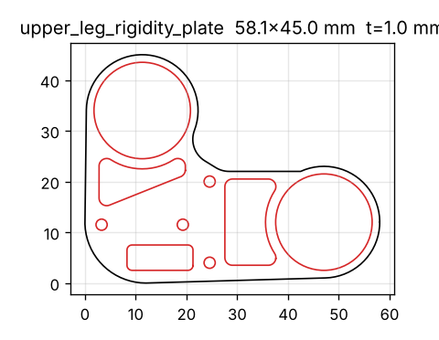
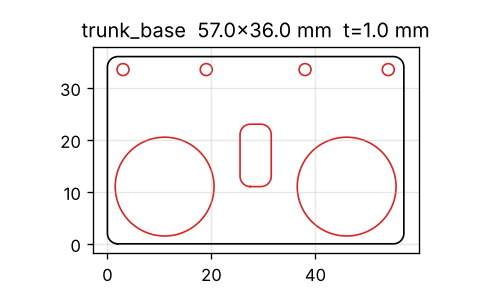
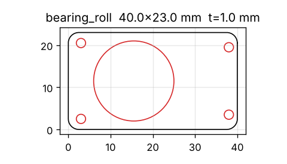
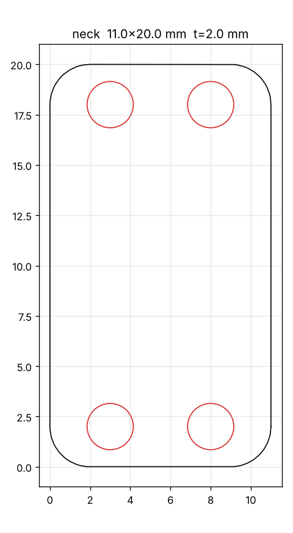

# 판재 부품

| 폴더 | 내용 |
|---|---|
| `dynamixel/` | 트랙 A: 원본에서 추출한 평판 4종 DXF + 미리보기 PNG + `plates.csv` |

- 생성: `python cad/tools/plates_to_dxf.py`
- 재질 알루미늄 5052/6061 (1 mm ×3종, 2 mm ×1종), 레이저·워터젯. 1 mm 판은 FR4(PCB)·카본 대체 가능.
- 시뮬레이션 메시에서 뽑은 형상이라 ±0.2 mm 오차 가능 → Fusion에서 정리 후 주문.
- 트랙 B 판재 후보와 주문 방법은 [`../FUSION_REDESIGN.md`](../FUSION_REDESIGN.md) 6절.
- 라이선스: 원본 메시 파생물 → CC BY-NC-SA 4.0 (© Pollen Robotics).

