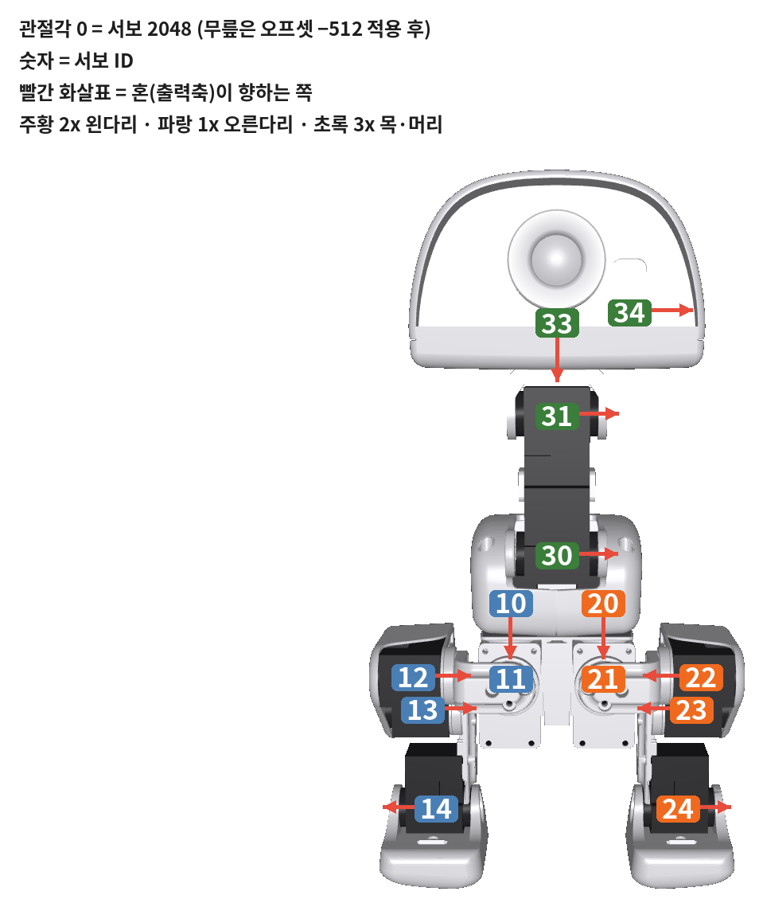
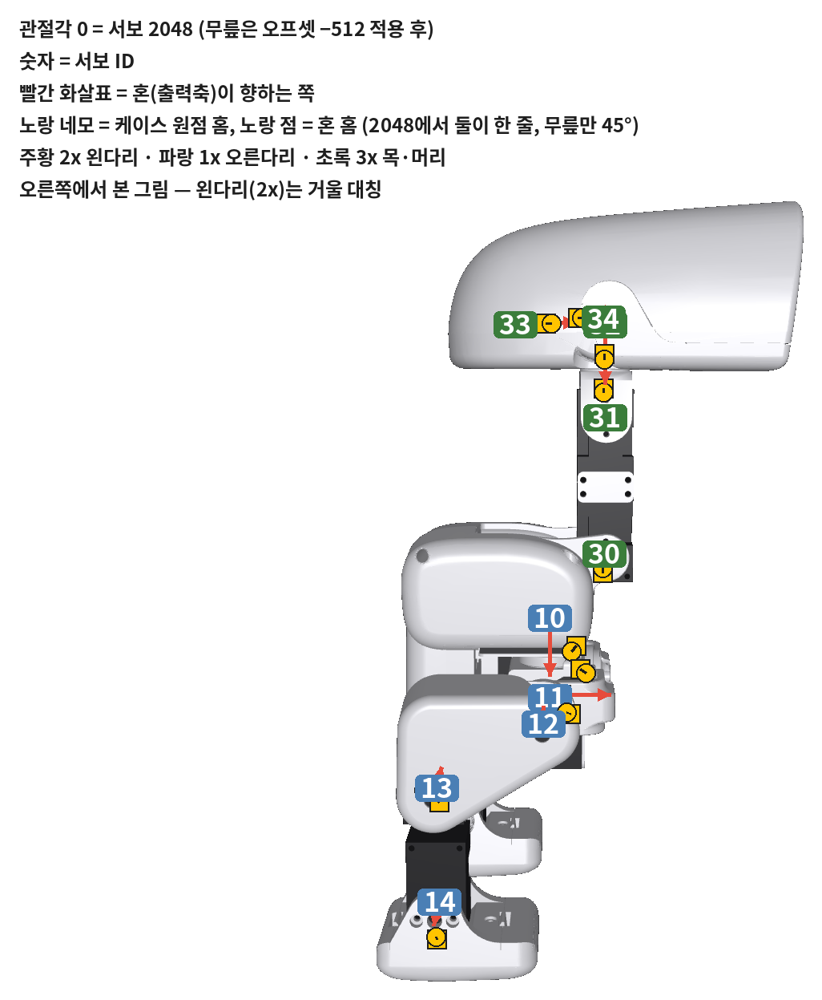
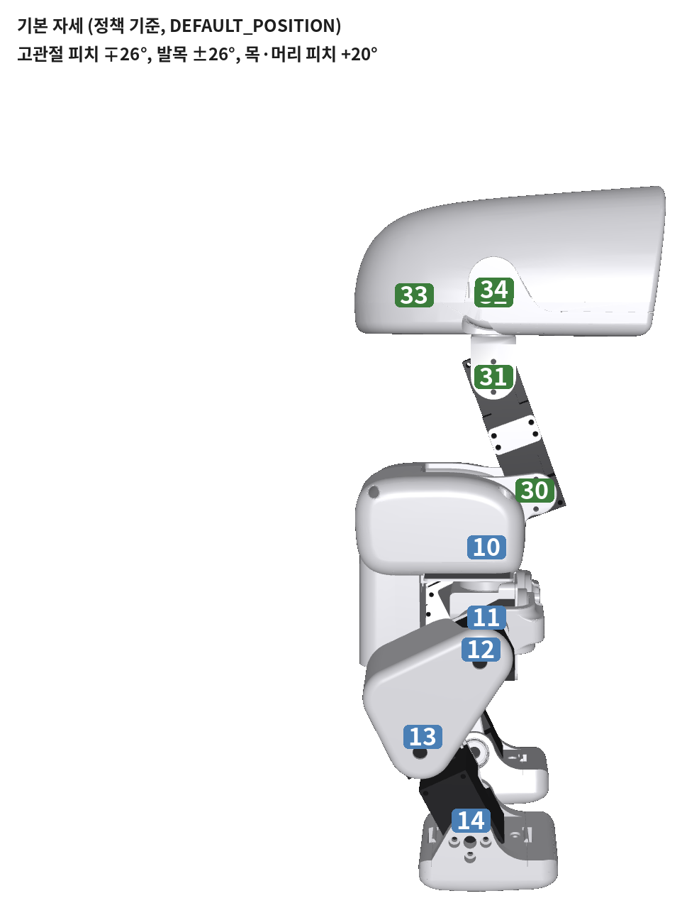
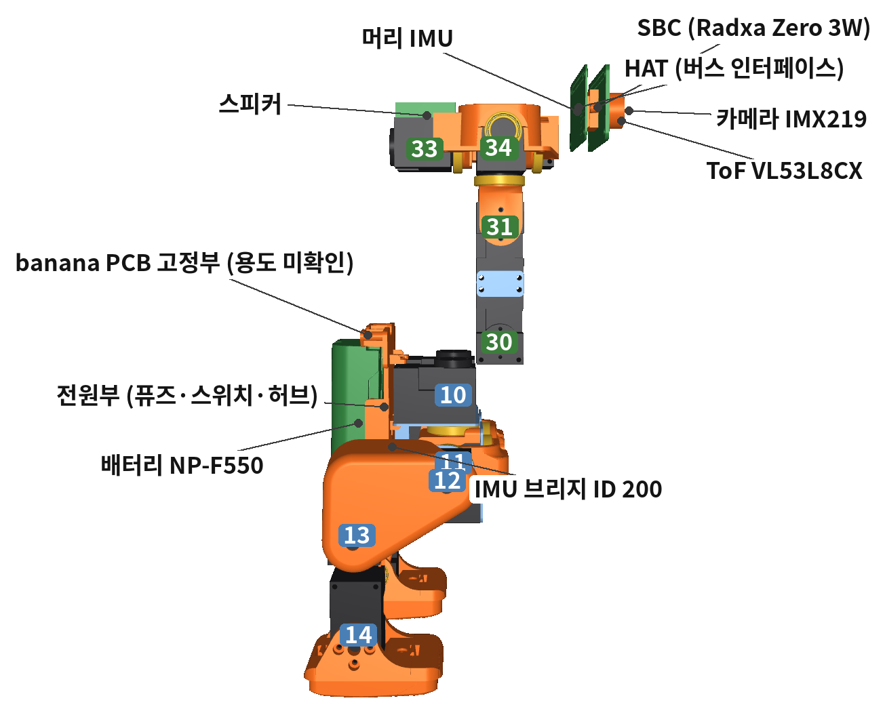
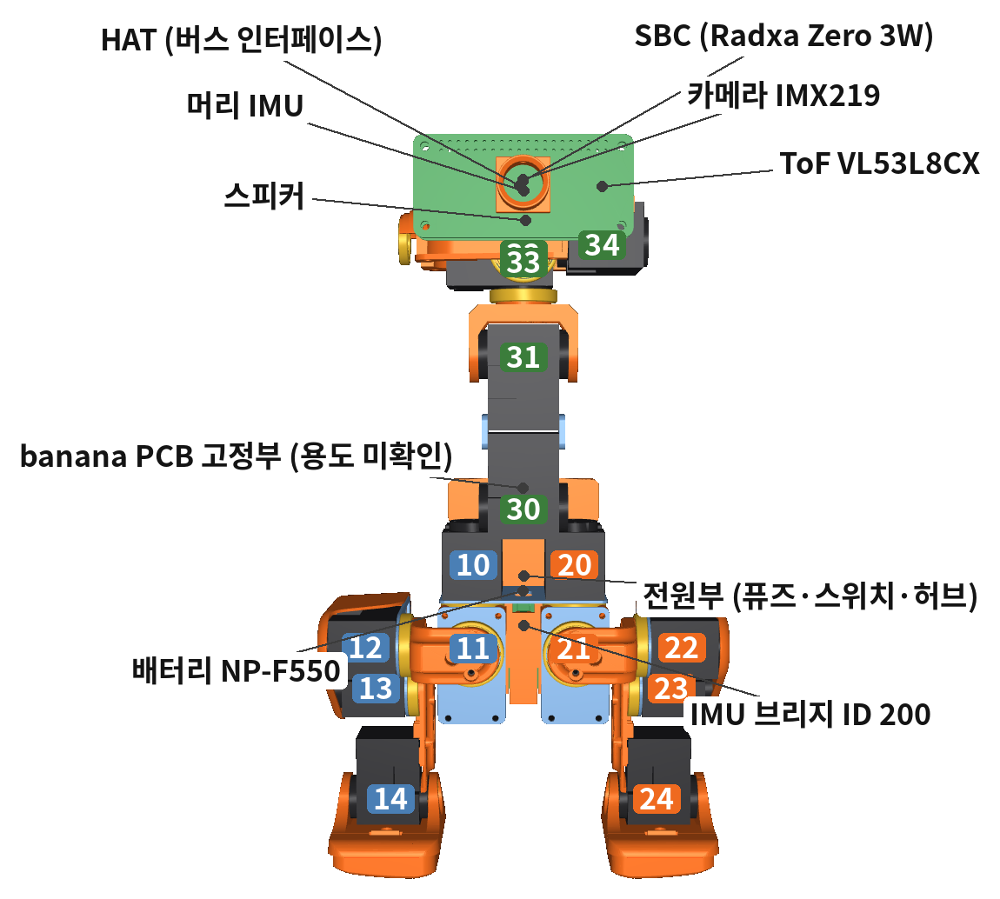
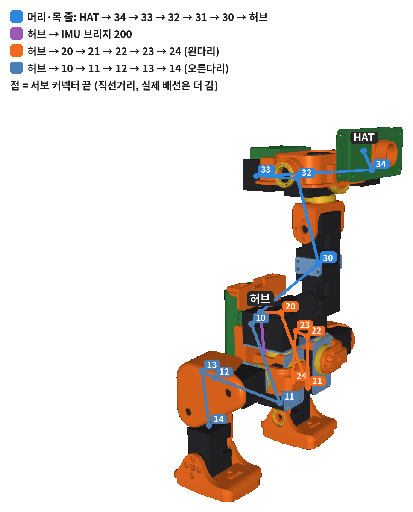

# 서보 원점 · 배선 · 부품 배치 · 제어 · 시뮬레이션 (트랙 A)

조립 가이드 PDF([`Microduck_Assembly_Guide.pdf`](Microduck_Assembly_Guide.pdf)) 7–10쪽, 27–32쪽과 같은 내용이다.
숫자는 원본 모델(`cad/reference`)과 Pollen 런타임(`pollen-robotics/microduck`, duck-control)에서 계산했다.
다시 만들기: `servo_zero.py` → `layout.py` → `build_guide.py` ([README](README.md)).

## 1. 서보 원점과 장착 방향

**원점 = 위치 2048 = 관절각 0 = CAD 조립 자세.** 런타임은 `각도 = 2π·위치/4096 − π`로 읽고 관절마다 부호를 바꾸지 않는다.
그래서 모든 서보는 **2048일 때 아래 원점 그림과 같은 모양**이 되게 부품을 붙인다.

- **+ 방향 = 혼을 마주 보고 반시계(CCW)** (Drive Mode 0, 공장값). 이것이 모델 관절 축의 + 회전과 같아야 한다.
  서보 몸체가 고정 쪽이면 혼이 관절 축 방향을, 몸체가 같이 도는 쪽이면 반대 방향을 향한다.
  **서보를 뒤집어 끼우면 그 관절만 방향이 반대**가 되고 정책이 바로 넘어진다.
- 이 규칙으로 정한 혼 방향은, 혼 나사가 한쪽에만 있어 형상으로 확인할 수 있는 12개 관절 모두와 일치했다.
  목 피치·머리 피치(양쪽 U자 브래킷)는 규칙으로만 정했다. 부리는 관절이 모델에 없어 부리 나사 위치로 판단했다.
- **무릎(13, 23)**: Homing Offset −512. Present = Actual + Offset이라 2048을 보내면 실제 축은 2560(+45°)에 간다.
  정강이 구멍이 그 각도에 맞춰져 있다 (정강이 구멍을 무릎 축으로 45° 돌리면 혼 구멍 4개와 정확히 겹침).
- 혼 구멍은 90° 간격 4개라 끼울 수 있는 각도는 4가지뿐이다. 90° 틀리면 눈에 보이고, 45°(무릎 오프셋 누락)면 구멍이 안 맞는다.

| ID | 관절 | 혼이 향하는 쪽 | 서보 몸체 | + 방향이면 | 가동 범위 | Homing | 기본 자세 (위치값) |
|---|---|---|---|---|---|---|---|
| 20 | 왼 고관절 요 (`left_hip_yaw`) | −Z (아래) | 고정 | 발끝이 오른쪽으로 돈다 | -25 … +30° | 0 | +0.0° (2048) |
| 21 | 왼 고관절 롤 (`left_hip_roll`) | +X (앞) | 고정 | 발이 왼쪽으로 | -22 … +22° | 0 | -5.0° (1991) |
| 22 | 왼 고관절 피치 (`left_hip_pitch`) | −Y (오른쪽) | 같이 돎 | 발이 뒤로 | -90 … +90° | 0 | -26.2° (1749) |
| 23 | 왼 무릎 (`left_knee`) | −Y (오른쪽) | 고정 | 발이 앞으로 | -90 … +90° | -512 | -0.3° (2045) |
| 24 | 왼 발목 (`left_ankle`) | +Y (왼쪽) | 고정 | 발끝이 아래로 | -90 … +90° | 0 | +26.0° (2343) |
| 10 | 오른 고관절 요 (`right_hip_yaw`) | −Z (아래) | 고정 | 발끝이 오른쪽으로 돈다 | -30 … +25° | 0 | +0.0° (2048) |
| 11 | 오른 고관절 롤 (`right_hip_roll`) | +X (앞) | 고정 | 발이 왼쪽으로 | -22 … +22° | 0 | +5.0° (2105) |
| 12 | 오른 고관절 피치 (`right_hip_pitch`) | +Y (왼쪽) | 같이 돎 | 발이 앞으로 | -90 … +90° | 0 | +26.2° (2347) |
| 13 | 오른 무릎 (`right_knee`) | +Y (왼쪽) | 고정 | 발이 뒤로 | -90 … +90° | -512 | +0.3° (2051) |
| 14 | 오른 발목 (`right_ankle`) | −Y (오른쪽) | 고정 | 발끝이 위로 | -90 … +90° | 0 | -26.0° (1753) |
| 30 | 목 피치 (`neck_pitch`) | +Y (왼쪽) | 같이 돎 | 부리가 뒤로 | -90 … +60° | 0 | +20.0° (2276) |
| 31 | 머리 피치 (`head_pitch`) | +Y (왼쪽) | 고정 | 부리가 아래로 | -90 … +90° | 0 | +20.0° (2276) |
| 32 | 머리 요 (`head_yaw`) | −Z (아래) | 같이 돎 | 얼굴이 왼쪽으로 돈다 | -170 … +170° | 0 | +0.0° (2048) |
| 33 | 머리 롤 (`head_roll`) | +X (앞) | 같이 돎 | 머리 윗부분이 왼쪽으로 기운다 | -25 … +25° | 0 | +0.0° (2048) |
| 34 | 부리 (`mouth`) | +Y (왼쪽) | — | 부리가 열린다 (닫힘 −5°, 최대 +30°) | -5 … +30° | 0 | +0.0° (2048) |

좌표: X 앞, Y 왼쪽, Z 위. 가동 범위 = MJCF. 기본 자세 = 런타임 `DEFAULT_POSITION` (정책이 서 있는 자세, 관측의 기준).

| 원점 (정면) | 원점 (오른쪽 옆) | 기본 자세 |
|---|---|---|
|  |  |  |

### 원점 맞추기 A · B · C

서보를 `dxl_zero.py zero`로 2048에 두고, 혼을 마주 보고 커넥터가 아래로 오게 든다.
**위 홈** = 케이스 끝면 가운데의 세로 홈(커넥터 반대쪽 끝), **혼 홈** = 혼 테두리의 홈.

| 원점 | 모양 | 해당 서보 |
|---|---|---|
| **A** | 위 홈과 혼 홈이 한 줄 | 무릎 빼고 13개 |
| **B** | 위 홈은 그대로, 혼 홈만 왼쪽(반시계)으로 45° | 무릎 13 · 23 (오프셋 −512를 쓴 뒤 2048) |
| **C** | 90°·180° 어긋남, 또는 무릎인데 한 줄 → **틀림** | `zero` 다시, 무릎은 오프셋 −512 확인 |

그림은 PDF 8쪽. 조립 단계 그림의 서보 이름표에도 "22 · 원점 A"처럼 적혀 있다.

| ID | 관절 | 원점 | 위 홈이 보는 쪽 (로봇 기준) |
|---|---|---|---|
| 20 | 왼 고관절 요 | **A** | 앞 |
| 21 | 왼 고관절 롤 | **A** | 위 |
| 22 | 왼 고관절 피치 | **A** | 앞 |
| 23 | 왼 무릎 | **B** | 아래 |
| 24 | 왼 발목 | **A** | 아래 |
| 10 | 오른 고관절 요 | **A** | 앞 |
| 11 | 오른 고관절 롤 | **A** | 위 |
| 12 | 오른 고관절 피치 | **A** | 앞 |
| 13 | 오른 무릎 | **B** | 아래 |
| 14 | 오른 발목 | **A** | 아래 |
| 30 | 목 피치 | **A** | 아래 |
| 31 | 머리 피치 | **A** | 위 |
| 32 | 머리 요 | **A** | 왼쪽 |
| 33 | 머리 롤 | **A** | 왼쪽 |
| 34 | 부리 | **A** | 뒤 |

1. `zero` → 2048, 토크 켬
2. 표의 글자(A/B)와 그림이 같은지 본다. C면 다시
3. '위 홈이 보는 쪽'이 로봇의 그 방향을 보게 서보를 프레임에 넣는다 (앞 = 부리 쪽, 왼쪽 = 로봇의 왼쪽)
4. 원점 자세 그림처럼 부품을 대고 혼 볼트

"홈 한 줄 = 2048"은 서보를 받으면 한 번 확인한다. 어긋나면 홈이 아니라 2048을 기준으로 조립한다.
재설계 출력물의 혼 자리에도 혼 홈 방향으로 표시선을 새긴다.

### 장착 순서

1. 서보 1개씩 설정: `python docs/assembly/tools/dxl_zero.py setup --port COM5 --new-id 23`
   (ID, 1 Mbps, return delay 0, PWM slope 255, shutdown 52, 무릎 homing −512, drive mode 0, 위치 제어).
2. 원점으로 보내고 **토크를 켠 채** 둔다: `dxl_zero.py zero --port COM5 --ids 23`. 벤치 전원은 5 V면 된다. 원점 A/B 그림과 같은지 본다.
3. 표의 혼 방향대로 서보를 프레임에 넣고, 원점 그림처럼 자식 부품을 대서 혼 볼트를 조인다.
4. `dxl_zero.py off` 후 손으로 끝까지 돌려 걸림·케이블 당김을 확인한다.
5. 다 조립하면 끈으로 매단 채 `zero --all` → 원점 그림과 비교, `home --all` → 기본 자세와 비교.
6. `robotctl monitor`에서 관절을 + 방향으로 밀어 부호를 확인한다.

토크를 끈 상태에서 혼을 돌렸다면 그 서보는 다시 `zero`. 원점 1° 오차는 고관절에서 발까지(95 mm) 약 1.7 mm다.
`dxl_zero.py`는 실물에서 아직 돌려 보지 않았다. 서보 1개로 먼저 시험한다 (DYNAMIXEL Wizard 2.0으로 같은 값을 써도 된다).

### 조립 단계별 다이나믹셀

PDF의 각 조립 단계 쪽에도 같은 내용이 빨간 상자("다이나믹셀 — 2048에 두고 체결")로 있고, 그림에는 "ID · 원점 A/B", 혼 방향 화살표, "혼 고정", 홈 위치(노랑 네모 = 위 홈, 노랑 점 = 혼 홈)가 있다.

| 단계 | ID | 관절 | 이 단계에서 | 위치 | 혼이 향함 | 원점 | 위 홈이 보는 쪽 |
|---|---|---|---|---|---|---|---|
| 2 | 24 | 왼 발목 | 서보 장착 + 혼 고정 | 2048 | 왼쪽 | **A** | 아래 |
| 2 | 14 | 오른 발목 | 서보 장착 + 혼 고정 | 2048 | 오른쪽 | **A** | 아래 |
| 3 | 22 | 왼 고관절 피치 | 서보 장착 | 2048 | 오른쪽 | **A** | 앞 |
| 3 | 12 | 오른 고관절 피치 | 서보 장착 | 2048 | 왼쪽 | **A** | 앞 |
| 3 | 23 | 왼 무릎 | 서보 장착 + 혼 고정 | 오프셋 −512 → 2048 | 오른쪽 | **B** | 아래 |
| 3 | 13 | 오른 무릎 | 서보 장착 + 혼 고정 | 오프셋 −512 → 2048 | 왼쪽 | **B** | 아래 |
| 4 | 22 | 왼 고관절 피치 | 혼 고정 | 2048 | 오른쪽 | **A** | 앞 |
| 4 | 12 | 오른 고관절 피치 | 혼 고정 | 2048 | 왼쪽 | **A** | 앞 |
| 5 | 20 | 왼 고관절 요 | 서보 장착 | 2048 | 아래 | **A** | 앞 |
| 5 | 10 | 오른 고관절 요 | 서보 장착 | 2048 | 아래 | **A** | 앞 |
| 6 | 20 | 왼 고관절 요 | 혼 고정 | 2048 | 아래 | **A** | 앞 |
| 6 | 10 | 오른 고관절 요 | 혼 고정 | 2048 | 아래 | **A** | 앞 |
| 7 | 21 | 왼 고관절 롤 | 서보 장착 + 혼 고정 | 2048 | 앞 | **A** | 위 |
| 7 | 11 | 오른 고관절 롤 | 서보 장착 + 혼 고정 | 2048 | 앞 | **A** | 위 |
| 9 | 30 | 목 피치 | 서보 장착 | 2048 | 왼쪽 | **A** | 아래 |
| 9 | 31 | 머리 피치 | 서보 장착 | 2048 | 왼쪽 | **A** | 위 |
| 10 | 30 | 목 피치 | 혼 고정 | 2048 | 왼쪽 | **A** | 아래 |
| 11 | 32 | 머리 요 | 서보 장착 + 혼 고정 | 2048 | 아래 | **A** | 왼쪽 |
| 11 | 33 | 머리 롤 | 서보 장착 + 혼 고정 | 2048 | 앞 | **A** | 왼쪽 |
| 12 | 31 | 머리 피치 | 혼 고정 | 2048 | 왼쪽 | **A** | 위 |
| 13 | 34 | 부리 | 서보 장착 | 2048 | 왼쪽 | **A** | 뒤 |
| 16 | 34 | 부리 | 혼 고정 | 2048 | 왼쪽 | **A** | 뒤 |

## 2. 부품 배치

| 옆 | 정면 |
|---|---|
|  |  |

| 부품 | X 앞 | Y 왼 | Z 위 |
|---|---|---|---|
| SBC (Radxa Zero 3W) | +68 | -0 | +133 |
| HAT (버스 인터페이스) | +60 | -1 | +132 |
| 배터리 NP-F550 | -36 | -0 | -4 |
| 전원부 (퓨즈·스위치·허브) | -24 | +0 | +3 |
| banana PCB 고정부 (용도 미확인) | -31 | -0 | +35 |
| 스피커 | -5 | +1 | +129 |
| IMU 브리지 ID 200 | -21 | +0 | -15 |
| 카메라 IMX219 | +81 | -0 | +131 |
| ToF VL53L8CX | +81 | +22 | +129 |
| 머리 IMU | +59 | +0 | +131 |
| 버스 허브 (권장 위치) | -24 | +0 | +15 |

mm, 몸통 원점, 관절각 0. 보드 자리는 모델의 Pi Zero 2W(Radxa Zero 3W도 65×30 mm). IMU 브리지·머리 IMU·카메라·ToF는 모델의 site 위치다.
허브는 권장 위치이고, `banana_pcb_locker`의 용도는 원본에서 확인하지 못했다.

## 3. 배선

Pollen의 실제 배선 경로는 공개돼 있지 않다. 아래는 부품 배치와 버스 사양에서 정한 권장안이다. 버스는 한 줄이라 순서를 바꿔도 동작은 같다.

```
머리   SBC(Radxa) ─UART2─ HAT(반이중 버퍼 SN74LVC2G241 + 5 V 강압) ─ 34 ─ 33 ─ 32
목                                                          32 ─ 31 ─ 30
몸통   배터리 NP-F550 ─ 퓨즈 5 A ─ 스위치 ─XT30─ 버스 허브(3핀 ×4 병렬) ─ 30
                                               ├─ IMU 브리지 200
                                               ├─ 20 ─ 21 ─ 22 ─ 23 ─ 24   왼다리
                                               └─ 10 ─ 11 ─ 12 ─ 13 ─ 14   오른다리
```

- 커넥터 (XL330·IMU 브리지·허브 공통): JST EH 2.5 mm 3핀, **1 GND · 2 VDD · 3 DATA** (ROBOTIS TTL 표준 — 자작 보드 전에 e-manual 그림으로 한 번 더 확인).
  XL330에는 같은 커넥터가 2개라 아무 쪽이나 이어도 된다.
- 전원: 배터리 → 퓨즈 → 스위치 → 허브. 서보 15개 + IMU 브리지 + HAT가 모두 2S 레일을 쓴다.
  HAT는 버스 케이블로 올라온 2S를 5 V(3 A 이상)로 강압해 SBC에 준다 → 목 케이블 하나에 신호·전원이 같이 간다.
- ⚠ **결정 D1**: XL330 정격은 3.7–6.0 V(권장 5 V)인데 원본은 2S(최대 8.2 V) 직결이다. 그래서 shutdown=52로 입력전압 보호를 끈다 ([plan.md](../../plan.md) D1).
- 신호: SBC UART2 `/dev/ttyS2` TX/RX + 방향 GPIO → 반이중 버퍼 → DATA. Armbian은 UART2에 콘솔을 띄우므로 `serial-getty@ttyS2`를 마스크한다.
  1단계 벤치는 HAT 대신 U2D2 + U2D2 Power Hub (plan.md 3.4절).



| 구간 | 직선 mm | |
|---|---|---|
| hat → 34 | 31 |  |
| 34 → 33 | 76 |  |
| 33 → 32 | 32 | 관절 통과 |
| 32 → 31 | 63 | 관절 통과 |
| 31 → 30 | 1 |  |
| 30 → hub | 66 | 관절 통과 |
| hub → imu | 30 |  |
| hub → 20 | 19 |  |
| 20 → 21 | 59 | 관절 통과 |
| 21 → 22 | 52 | 관절 통과 |
| 22 → 23 | 12 |  |
| 23 → 24 | 42 | 관절 통과 |
| hub → 10 | 19 |  |
| 10 → 11 | 59 | 관절 통과 |
| 11 → 12 | 52 | 관절 통과 |
| 12 → 13 | 12 |  |
| 13 → 14 | 42 | 관절 통과 |

커넥터 끝(서보 아래 끝면 중앙)끼리의 직선거리. 실제 배선은 1.3–1.8배라도 **동봉 X3P 180 mm**로 길이는 충분하다.
가닥 수는 17가닥(머리·목 6, IMU 1, 다리 5×2)인데 서보 동봉분은 15가닥 → **2가닥 추가**.
관절을 지나는 구간은 회전 중심 가까이로 지나게 하고, 가동 범위 끝까지 돌려 당김이 없게 고리를 남긴다 (특히 머리 요 ±170°).

## 4. 제어 방법 (Pollen 런타임 robotd)

50 Hz 루프, 한 틱에:

1. **Fast Sync Read** 1회 (주소 124–136: PWM·전류·속도·위치) + IMU 브리지(ID 200). 전압·온도(144–146)는 1초마다.
2. 관측 61개 → **ONNX 정책** → 액션 14개 (부리 제외).
3. 목표각 = 기본 자세 + `action_scale`(걷기 0.9) × 액션, 배터리 전압 보정(7.4 V / 측정값).
4. 1차 로우패스 (다리 0.7, 머리 0.5 — robotd.toml 기본값) → **Sync Write Goal Position**. 부리는 정책 밖에서 따로 (−5°…+30°).
5. 서보 내부 위치 P 제어: **kP 200, I = D = 0** (서기는 × 0.8). 시뮬레이션의 kp 0.55 N·m/rad에 해당.

| index | 폭 | 관측 내용 |
|---|---|---|
| 0–2 | 3 | 자이로 (몸통, rad/s) |
| 3–5 | 3 | 중력 방향 (몸통 기준 단위벡터) |
| 6–19 | 14 | 관절각 − 기본 자세 (부리 제외) |
| 20–33 | 14 | 관절 속도 |
| 34–47 | 14 | 직전 액션 |
| 48–50 | 3 | 명령 vx, vy, vyaw |
| 51–54 | 4 | 머리 명령: 목 피치, 머리 피치·요·롤 |
| 55–60 | 6 | 몸 자세 명령 x, y, z, roll, pitch, yaw (x·y·yaw는 0) |

안전: 중력 방향으로 넘어짐 판정, 명령이 끊기면 속도 0(데드맨), `robotctl relax --yes`로 토크 끔(넘어짐 주의).

⚠ 로우패스: robotd.toml은 "정책이 이 값으로 학습됨"이라 적고, microduck_rl AGENTS.md는 "필터 없이 학습"이라 적는다 (2026-10 기준 두 저장소가 다르다).
직접 학습한 정책을 쓸 때는 학습 설정과 런타임 필터를 맞춘다.

자주 쓰는 명령: `robotctl health` · `robotctl monitor` · `robotctl policy load walk <org/name>` ·
`sudo systemctl stop robotd && sudo /opt/robot/daemon/current/bin/robotd init && sudo systemctl start robotd`(레지스터 재설정).

## 5. 시뮬레이션 방법

| 레벨 | 무엇 | 명령 / Windows 메뉴 | 필요 | 확인할 것 |
|---|---|---|---|---|
| 1 | 모델 보기 | `uv run python -m mujoco.viewer --mjcf=cad/reference/microduck/scene.xml` · START_HERE 1 | CPU | 키프레임 `INIT` = 모든 서보 2048 (원점 그림과 같음). Control 슬라이더로 + 방향 확인 |
| 1 | 토크 점검 | `uv run python sim/check_model.py --servo xl330 --vin 7.4 --key STAND` · START_HERE 2 | CPU | 관절별 필요 토크 vs 정지토크 |
| 2 | 정책을 키보드로 | `uv run scripts/infer_policy.py --walking walk.onnx --standing stand.onnx` (microduck_rl) · START_HERE 9 | CPU, Linux 권장 | `--save-csv`로 기록해 실물과 비교, `--no-bam`으로 이상적 PD와 비교 |
| 3 | 실제 런타임 + MuJoCo | `scripts/duck-sim` → `drive 0.15 0`, `ctl health`, `monitor`, `down` (microduck) | Linux, Rust | robotd가 실물과 같은 코드로 돈다. 실시간 1.0× 미만이면 넘어진다 |
| 학습 | 걷기 정책 | `uv run train Mjlab-Velocity-Flat-MicroDuck --env.scene.num-envs 4096` → `play` → `scripts/export.py` · START_HERE 10 | NVIDIA GPU (또는 `--hf-jobs`) | 배포는 export.py로 만든 ONNX만, Backlash 변형 우선 |

시뮬레이션 ↔ 실물 맞추기: 원점(`zero --all` = `INIT`), 부호(슬라이더 = `robotctl monitor`), 기본 자세(`home --all` = DEFAULT_POSITION),
동특성(같은 명령을 양쪽에서 → 관절각·기울기 비교. 백래시 ±1°, 마찰, 지연 3–6틱, 전압 강하 순으로 의심).
학습과 duck-sim은 Rhoban BAM 액추에이터 모델을 쓴다. 서보나 전원(5 V)을 바꾸면 서보 1개로 BAM을 다시 측정하고 재학습한다 (plan.md 3.2·6.4절).

## 출처

- Pollen 런타임 `duck-control/src/model.rs`(ID, DEFAULT_POSITION, homing, 레지스터), `bus.rs`(각도식, 게인), `obs.rs`(관측), `deploy/robotd.toml`(루프·스케일·필터), `docs/robot/simulation.md`
- Pollen 학습 `microduck_rl` README·AGENTS.md, MJCF `joints_properties.xml`
- [ROBOTIS XL330-M288 e-manual](https://emanual.robotis.com/docs/en/dxl/x/xl330-m288/) (컨트롤 테이블, CCW = +, Homing Offset, 3.7–6.0 V)
